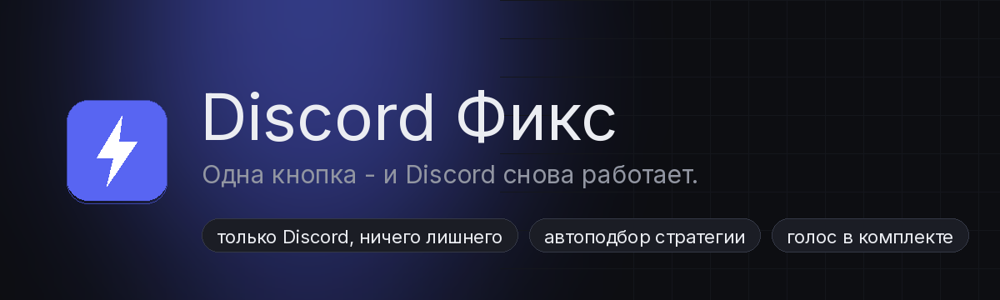

**Русский** | [English](README.en.md) | [Español](README.es.md) | [Português](README.pt.md)

# Discord Фикс



Одна кнопка, и Discord снова работает в России. Остальной интернет приложение не трогает: банки, игры, торренты и всё остальное работают как работали.

[](../../releases)
[](LICENSE)
[](../../releases)

## Как пользоваться (3 шага)

**1. Скачай**

Жми сюда: **[скачать discord-fix-windows.zip](https://github.com/hilsetapp/discord-fix/releases/latest/download/discord-fix-windows.zip)** (около 5 МБ).

Важно: зелёная кнопка «Code» наверху страницы качает исходники - они нужны только программистам, exe там нет. Тебе нужен именно архив по ссылке выше.

**2. Распакуй**

Кликни правой кнопкой по архиву и выбери «Извлечь всё». Получится папка. В ней лежит `discord-fix.exe` - её и запускай.

Если Windows при первом запуске покажет синее окно SmartScreen - нажми «Подробнее», потом «Выполнить в любом случае». Это стандартная реакция на новые программы без платной подписи, у каждого автора без сертификата так.

**3. Нажми большую кнопку**

При запуске Windows спросит разрешение администратора (UAC) - нажми «Да». Оно нужно системному драйверу обхода, так устроены все подобные программы. Не переживай, кроме запуска драйвера права никуда не расходуются.

Откроется тёмное окно. Жми круглую кнопку посередине. Программа сама переберёт стратегии обхода и остановится, когда Discord начнёт открываться. Обычно это 10-60 секунд.

После этого запускай Discord как обычно - сайт, приложение, голосовые каналы.

Готово. Окно можно свернуть, программа будет работать в фоне. Чтобы всё выключить - нажми кнопку ещё раз или просто закрой окно.

## Что внутри

- **Авто-подбор стратегии.** У разных провайдеров блокировка устроена по-разному. Приложение само пробует 4 рабочие схемы по очереди и проверяет, открылся ли Discord по-настоящему.
- **Только Discord.** Обход применяется к списку доменов Discord и больше ни к чему. Скорость остального интернета не меняется, ничего лишнего не ломается.
- **Голос тоже.** Пропускаются и голосовые пакеты (UDP), так что звонки работают, а не только чат.
- **Один файл.** Тёмное аккуратное окно, журнал для любопытных, автозапуск с Windows по желанию, никакой консоли.

Проверенные двигатели внутри: [zapret](https://github.com/bol-van/zapret) от bol-van и запасной режим [GoodbyeDPI](https://github.com/ValdikSS/GoodbyeDPI) от ValdikSS. Это открытые проекты с годами истории, а приложение - аккуратная обёртка над ними.

## Если не помогло

По честному: волшебной кнопки на все случаи не бывает. Что попробовать:

1. **Смотри журнал.** Разверни список внизу окна. Если там «движок выключился сразу после старта» - программа запущена без прав администратора. Закрой её и запусти заново, разреши UAC.
2. **Другая стратегия.** Автоматика ошибается. Открой список «Стратегия обхода» и попробуй конкретную вместо «Авто». Часто выигрывает «Стандарт» или «Провайдер-стиль».
3. **Перезапусти Discord.** Полностью, через трей у часов, а не крестиком окна. Потом перезапусти обход.
4. **Нет голоса, но чат есть?** Значит твоя сеть особенно хитрая. Попробуй стратегию «Запасной (GoodbyeDPI)» - она чинит сайт и чат, но голосовые каналы в ней, увы, не заводятся.
5. **Смени DNS.** На 1.1.1.1 или 8.8.8.8 в настройках адаптера - иногда провайдер глушит ещё и домены.

Не помогло совсем - [напиши issue](../../issues/new), приложи то, что в журнале, и название провайдера. Попробуем разобраться.

## Чем это отличается от популярных батников

Решение «скачай папку и кликай разные .bat до победного» существует давно, оно хорошее, и наши двигатели те же самые. Разница тут в подаче:

- одно приложение вместо дюжины bat-файлов;
- автоматика сама проверит, поднялся ли Discord, а не предложит тебе гадать;
- обход только для Discord из коробки - у классических сборок часто едет один общий список на YouTube, игры и всё подряд;
- исполняемый файл собирается на GitHub из этого самого кода - видно, что внутри нет сюрпризов.

## Безопасность и доверие

- Код приложения открыт, весь в этом репозитории.
- Релизный `.exe` собирается GitHub Actions прямо из репозитория (смотри `.github/workflows`) - никаких сборок «на домашнем ноутбуке».
- Бинарные движки (zapret, GoodbyeDPI) скачаны из официальных релизов их авторов, их контрольные суммы зашиты в приложение - при запуске `-selftest` они перепроверяются. Скрипты в `scripts/verify-cores` сделают то же самое вручную.
- Антивирусы иногда ругаются на WinDivert - это системный драйвер фильтрации пакетов, который используют все подобные решения. Такова природа инструмента. Добавь папку приложения в исключения антивируса, если он мешает.

## Что приложение не делает

Чтобы всё было честно:

- это не VPN и не прокси - никакой «замены страны» и анонимности;
- ничего не отправляет на сторонние серверы, кроме проверки доступности открытых адресов Discord;
- не трогает настройки браузера, сертификаты и hosts-файл;
- не ускоряет интернет и не влияет на другие сервисы.

## Сборка из исходников

Нужно: Windows, Go 1.24+, права не требуются для сборки.

```
git clone https://github.com/hilsetapp/discord-fix.git
cd discord-fix
go build -ldflags "-H=windowsgui -s -w" -o discord-fix.exe ./cmd/discord-fix
```

Полезные флаги exe:

```
discord-fix.exe            - обычный режим с окном
discord-fix.exe -check     - проверить, открывается ли Discord
discord-fix.exe -selftest  - проверить хеши движков и целостность
discord-fix.exe -run=auto  - работа без окна, из командной строки
```

## Лицензии

- Код этого приложения - [MIT](LICENSE).
- Движки: zapret (MIT), GoodbyeDPI (Apache-2.0), WinDivert (LGPLv3). Тексты лицензий лежат в `licenses/`, подробности в [THIRD_PARTY_NOTICES.md](THIRD_PARTY_NOTICES.md).

Спасибо авторам zapret, GoodbyeDPI, WinDivert, Gio и шрифта Inter - на их работе всё и стоит.
